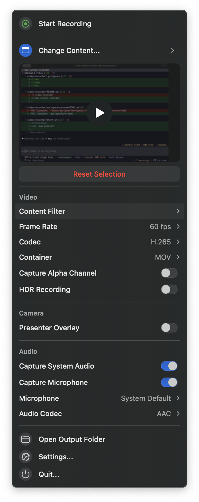

# mac-screen-recorder



Open [BetterCapture](https://github.com/jsattler/BetterCapture), a native macOS menu bar screen recorder, with one command:

```bash
git clone https://github.com/djson9/mac-screen-recorder.git && cd mac-screen-recorder && ./start.sh
```

Already cloned? Run `./start.sh` from the repository root.

The launcher opens BetterCapture if it is installed, or installs the official Homebrew cask first. First-time installation needs [Homebrew](https://brew.sh), an Apple Silicon Mac, and macOS 15.2 or later.

Click the BetterCapture icon in the menu bar, choose the screen or window to capture, and grant Screen Recording permission when macOS asks. Opening the app does not start a recording. Recordings stay on your Mac.

BetterCapture is an upstream MIT-licensed app by Joshua Sattler. This repository contains the launcher and the original recorder evaluations; BetterCapture's source and license are available in its [upstream repository](https://github.com/jsattler/BetterCapture).

## CLI recording

To run the five-second, full-screen recording example with Node.js 20 or later:

```bash
(cd poc/aperture-node && npm ci && node record.mjs)
```

The recording is saved to `poc/aperture-node/output.mp4`. Grant your terminal Screen Recording permission in System Settings if needed. Recording files are ignored by Git.

## Original evaluations

The following hands-on evaluations were recorded on May 28, 2026. Version and maintenance observations describe that date. They cover three working CLI proofs of concept and two menu bar apps.

## TL;DR

- **Node/JS** → use [`wulkano/aperture-node`](https://github.com/wulkano/aperture-node)
- **Rust, macOS-only** → use [`doom-fish/screencapturekit-rs`](https://github.com/doom-fish/screencapturekit-rs)
- **Rust, cross-platform** → use [`CapSoftware/scap`](https://github.com/CapSoftware/scap) + ffmpeg

See `poc/<tool>/EVAL.md` for detailed per-tool findings.

## Prerequisites

- macOS 14+ (Sonoma) — ScreenCaptureKit is the underlying API
- Grant your terminal **Screen Recording** permission: System Settings → Privacy & Security → Screen Recording → add Terminal / iTerm
- `ffmpeg` for the scap POC: `brew install ffmpeg`
- Node 20+ for aperture-node
- Rust 1.85+ (`rustup default stable`) for the Rust POCs

---

## 1. aperture-node (Node, easiest)

What it is: npm package that bundles a prebuilt Swift binary using ScreenCaptureKit. Backs the Kap app.

```bash
cd poc/aperture-node
npm install
node record.mjs
```

Produces `output.mp4` — H.264, 30 fps, full native resolution, ~2 MB / 5s.

What `record.mjs` does:
1. `import { recorder, screens, videoCodecs } from 'aperture'`
2. `await screens()` to list displays
3. `await recorder.startRecording({ fps: 30, screenId, videoCodec: 'h264', showCursor: true })`
4. `await wait(5000)`
5. `const tmpPath = await recorder.stopRecording()` — aperture writes to a tempfile
6. Copy tmpPath to `./output.mp4`

---

## 2. screencapturekit-rs (Rust, cleanest)

What it is: idiomatic Rust bindings to Apple's ScreenCaptureKit. Uses `SCRecordingOutput` (macOS 15+) so you get an encoded MP4 directly — no AVAssetWriter, no ffmpeg.

```bash
cd poc/screencapturekit-rs
cargo build --release

# Workaround for libswift_Concurrency.dylib rpath bug:
DYLD_FALLBACK_LIBRARY_PATH=$(xcrun --show-sdk-path)/../../../Toolchains/XcodeDefault.xctoolchain/usr/lib/swift/macosx \
  cargo run --release
```

Produces `/tmp/sck_poc_recording.mp4` — H.264, 1920x1080, ~57 fps, ~1.7 MB / 5s.

What `src/main.rs` does:
1. `SCShareableContent::get()` — enumerate displays/windows
2. `SCContentFilter::create().with_display(...).build()`
3. `SCStreamConfiguration::new().with_width(1920).with_height(1080).with_pixel_format(BGRA).with_shows_cursor(true)`
4. `SCRecordingOutput::new(SCRecordingOutputConfiguration::new().with_output_url(...).with_video_codec(H264).with_output_file_type(MP4))`
5. `stream.add_recording_output(&recording_output)`
6. `stream.start_capture()`, sleep 5s, `stream.stop_capture()`

Known issue: the produced binary references `@rpath/libswift_Concurrency.dylib` with no `LC_RPATH` set. Fix with a `build.rs` that emits `cargo:rustc-link-arg=-Wl,-rpath,/usr/lib/swift`, or use the `DYLD_FALLBACK_LIBRARY_PATH` workaround above.

---

## 3. scap (Rust, cross-platform)

What it is: cross-platform Rust screen capture library. **Frame-pump only** — gives you BGRA frames; you encode them yourself (here, by piping to ffmpeg).

```bash
cd poc/scap-rust
cargo build --release
cargo run --release
```

Produces `out.mp4` — H.264 (libx264 via ffmpeg), 720p, 30 fps, ~200 KB / 5s.

What `src/main.rs` does:
1. `scap::has_permission()` / `request_permission()`
2. `scap::get_all_targets()` — enumerate displays/windows
3. Build `Capturer` with `Options { fps: 30, target, output_type: BGRAFrame, output_resolution: _720p, ... }`
4. `capturer.start_capture()`
5. Spawn `ffmpeg -f rawvideo -pix_fmt bgra -s WxH -r 30 -i - -c:v libx264 -pix_fmt yuv420p out.mp4`
6. Loop `capturer.get_next_frame()` and write BGRA bytes to ffmpeg stdin for 5s
7. `capturer.stop_capture()`, close ffmpeg stdin to flush

---

## Eliminated candidates

These are GUI-only — no CLI surface, no URL scheme, no AppleScript dictionary:

- **jsattler/BetterCapture** — SwiftUI MenuBarExtra app, requires user click in `SCContentSharingPicker`
- **Mnpn/Azayaka** — menu-bar app, zero argv handling

Their ScreenCaptureKit + AVAssetWriter source is forkable as *reference* (especially Azayaka's macOS 13/14 vs 15+ dual-path in `Recording.swift`), but lifting it would be a port, not a reuse.

## Permissions note

First recording from a new terminal will silently produce a black video until you grant Screen Recording permission. There is no programmatic way to detect this from any of these tools — recommend adding a pixel-variance check on the first frame and surfacing the System Settings deep link if it's black.
